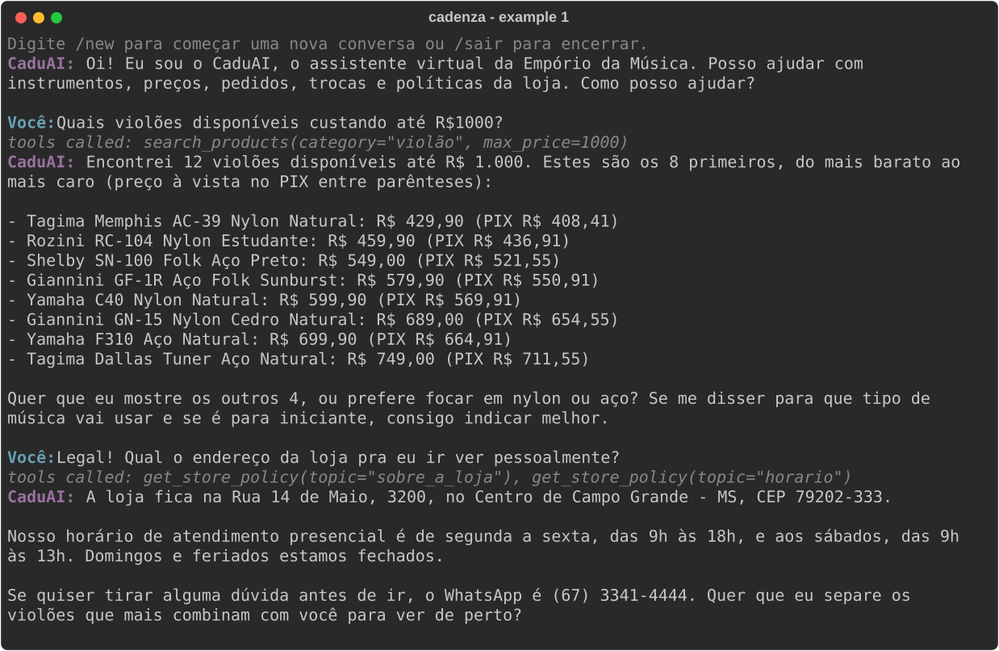

# Example 1: Catalog search, then the store address

The agent lists the available acoustic guitars up to R$ 1,000 from the catalog tool, then answers the address from the store manual: data first, then policy. `EMPORIO_NOW=2026-02-20T10:00`, model `anthropic/claude-haiku-5-5`.
Generated by `scripts/generate_examples.py`; not edited by hand.

---

**CaduAI:** Oi! Eu sou o CaduAI, o assistente virtual da Empório da Música. Posso ajudar com instrumentos, preços, pedidos, trocas e políticas da loja. Como posso ajudar?

**Customer:** Quais violões disponíveis custando até R$1000?

> Tools called: `search_products(category="violão", max_price=1000)`

**CaduAI:** Encontrei 12 violões disponíveis até R$ 1.000. Estes são os 8 primeiros, do mais barato ao mais caro (preço à vista no PIX entre parênteses):

- Tagima Memphis AC-39 Nylon Natural: R$ 429,90 (PIX R$ 408,41)
- Rozini RC-104 Nylon Estudante: R$ 459,90 (PIX R$ 436,91)
- Shelby SN-100 Folk Aço Preto: R$ 549,00 (PIX R$ 521,55)
- Giannini GF-1R Aço Folk Sunburst: R$ 579,90 (PIX R$ 550,91)
- Yamaha C40 Nylon Natural: R$ 599,90 (PIX R$ 569,91)
- Giannini GN-15 Nylon Cedro Natural: R$ 689,00 (PIX R$ 654,55)
- Yamaha F310 Aço Natural: R$ 699,90 (PIX R$ 664,91)
- Tagima Dallas Tuner Aço Natural: R$ 749,00 (PIX R$ 711,55)

Quer que eu mostre os outros 4, ou prefere focar em nylon ou aço? Se me disser para que tipo de música vai usar e se é para iniciante, consigo indicar melhor.

**Customer:** Legal! Qual o endereço da loja pra eu ir ver pessoalmente?

> Tools called: `get_store_policy(topic="sobre_a_loja")`, `get_store_policy(topic="horario")`

**CaduAI:** A loja fica na Rua 14 de Maio, 3200, no Centro de Campo Grande - MS, CEP 79202-333.

Nosso horário de atendimento presencial é de segunda a sexta, das 9h às 18h, e aos sábados, das 9h às 13h. Domingos e feriados estamos fechados.

Se quiser tirar alguma dúvida antes de ir, o WhatsApp é (67) 3341-4444. Quer que eu separe os violões que mais combinam com você para ver de perto?
