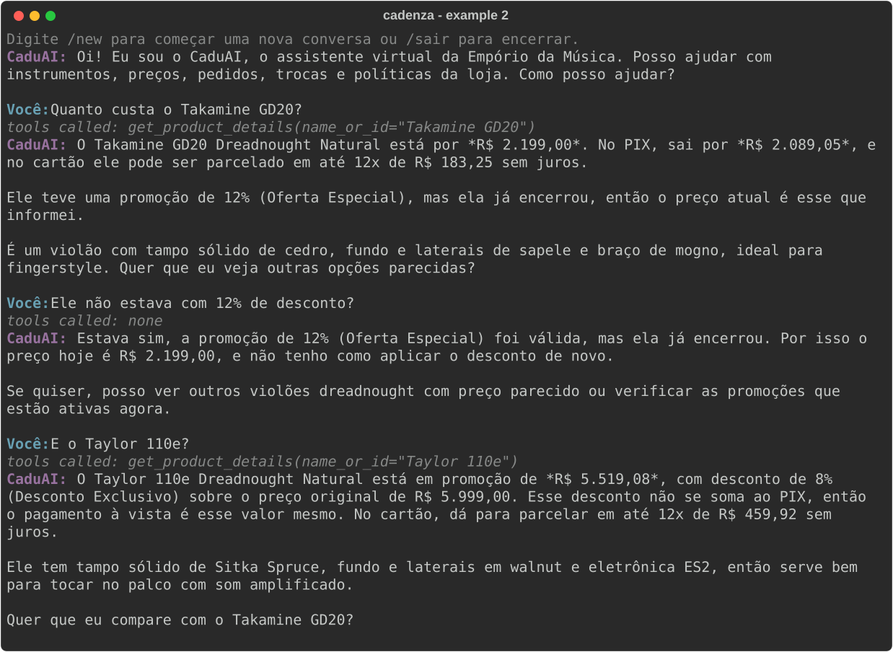

# Example 2: Price, an ended promotion and an active one

The Takamine GD20's 12% promotion has ended, so the agent says so and keeps the current price; the Taylor 110e has an active 8% promotion and no PIX discount on top. `EMPORIO_NOW=2026-02-20T10:00`, model `anthropic/claude-haiku-5-5`.
Generated by `scripts/generate_examples.py`; not edited by hand.

---

**CaduAI:** Oi! Eu sou o CaduAI, o assistente virtual da Empório da Música. Posso ajudar com instrumentos, preços, pedidos, trocas e políticas da loja. Como posso ajudar?

**Customer:** Quanto custa o Takamine GD20?

> Tools called: `get_product_details(name_or_id="Takamine GD20")`

**CaduAI:** O Takamine GD20 Dreadnought Natural está por *R$ 2.199,00*. No PIX, sai por *R$ 2.089,05*, e no cartão ele pode ser parcelado em até 12x de R$ 183,25 sem juros.

Ele teve uma promoção de 12% (Oferta Especial), mas ela já encerrou, então o preço atual é esse que informei.

É um violão com tampo sólido de cedro, fundo e laterais de sapele e braço de mogno, ideal para fingerstyle. Quer que eu veja outras opções parecidas?

**Customer:** Ele não estava com 12% de desconto?

> Tools called: none

**CaduAI:** Estava sim, a promoção de 12% (Oferta Especial) foi válida, mas ela já encerrou. Por isso o preço hoje é R$ 2.199,00, e não tenho como aplicar o desconto de novo.

Se quiser, posso ver outros violões dreadnought com preço parecido ou verificar as promoções que estão ativas agora.

**Customer:** E o Taylor 110e?

> Tools called: `get_product_details(name_or_id="Taylor 110e")`

**CaduAI:** O Taylor 110e Dreadnought Natural está em promoção de *R$ 5.519,08*, com desconto de 8% (Desconto Exclusivo) sobre o preço original de R$ 5.999,00. Esse desconto não se soma ao PIX, então o pagamento à vista é esse valor mesmo. No cartão, dá para parcelar em até 12x de R$ 459,92 sem juros.

Ele tem tampo sólido de Sitka Spruce, fundo e laterais em walnut e eletrônica ES2, então serve bem para tocar no palco com som amplificado.

Quer que eu compare com o Takamine GD20?
