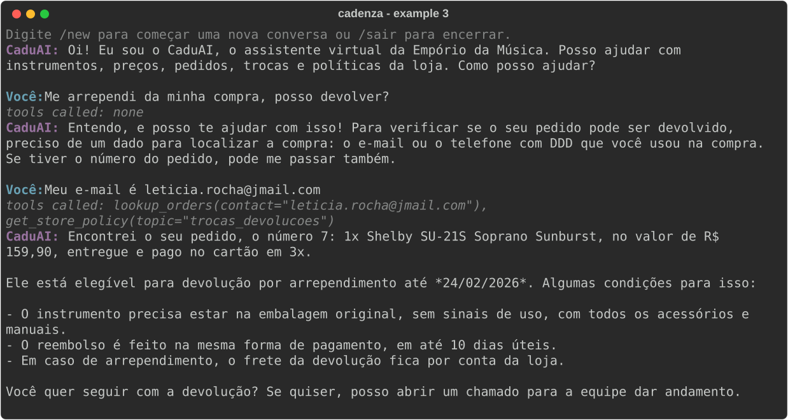

# Example 3: Return request checked against the order

The agent asks for a contact, the code verifies it and finds order 7, delivered on 17/02/2026, still inside the 7-day regret window. `EMPORIO_NOW=2026-02-20T10:00`, model `anthropic/claude-haiku-5-5`.
Generated by `scripts/generate_examples.py`; not edited by hand.

---

**CaduAI:** Oi! Eu sou o CaduAI, o assistente virtual da Empório da Música. Posso ajudar com instrumentos, preços, pedidos, trocas e políticas da loja. Como posso ajudar?

**Customer:** Me arrependi da minha compra, posso devolver?

> Tools called: none

**CaduAI:** Entendo, e posso te ajudar com isso! Para verificar se o seu pedido pode ser devolvido, preciso de um dado para localizar a compra: o e-mail ou o telefone com DDD que você usou na compra. Se tiver o número do pedido, pode me passar também.

**Customer:** Meu e-mail é leticia.rocha@jmail.com

> Tools called: `lookup_orders(contact="leticia.rocha@jmail.com")`, `get_store_policy(topic="trocas_devolucoes")`

**CaduAI:** Encontrei o seu pedido, o número 7: 1x Shelby SU-21S Soprano Sunburst, no valor de R$ 159,90, entregue e pago no cartão em 3x.

Ele está elegível para devolução por arrependimento até *24/02/2026*. Algumas condições para isso:

- O instrumento precisa estar na embalagem original, sem sinais de uso, com todos os acessórios e manuais.
- O reembolso é feito na mesma forma de pagamento, em até 10 dias úteis.
- Em caso de arrependimento, o frete da devolução fica por conta da loja.

Você quer seguir com a devolução? Se quiser, posso abrir um chamado para a equipe dar andamento.
