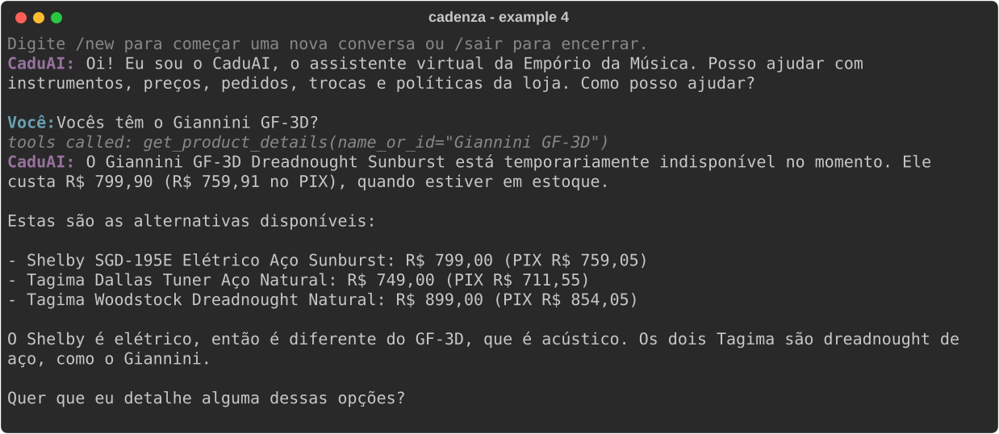

# Example 4: Out-of-stock product with alternatives

The Giannini GF-3D is active but has zero stock; the agent says it is temporarily unavailable and offers available steel-string guitars close in price. `EMPORIO_NOW=2026-02-20T10:00`, model `anthropic/claude-haiku-5-5`.
Generated by `scripts/generate_examples.py`; not edited by hand.

---

**CaduAI:** Oi! Eu sou o CaduAI, o assistente virtual da Empório da Música. Posso ajudar com instrumentos, preços, pedidos, trocas e políticas da loja. Como posso ajudar?

**Customer:** Vocês têm o Giannini GF-3D?

> Tools called: `get_product_details(name_or_id="Giannini GF-3D")`

**CaduAI:** O Giannini GF-3D Dreadnought Sunburst está temporariamente indisponível no momento. Ele custa R$ 799,90 (R$ 759,91 no PIX), quando estiver em estoque.

Estas são as alternativas disponíveis:

- Shelby SGD-195E Elétrico Aço Sunburst: R$ 799,00 (PIX R$ 759,05)
- Tagima Dallas Tuner Aço Natural: R$ 749,00 (PIX R$ 711,55)
- Tagima Woodstock Dreadnought Natural: R$ 899,00 (PIX R$ 854,05)

O Shelby é elétrico, então é diferente do GF-3D, que é acústico. Os dois Tagima são dreadnought de aço, como o Giannini.

Quer que eu detalhe alguma dessas opções?
